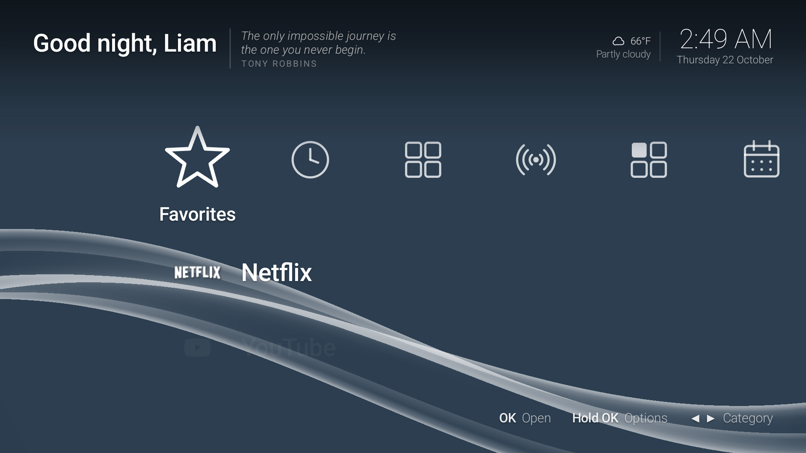
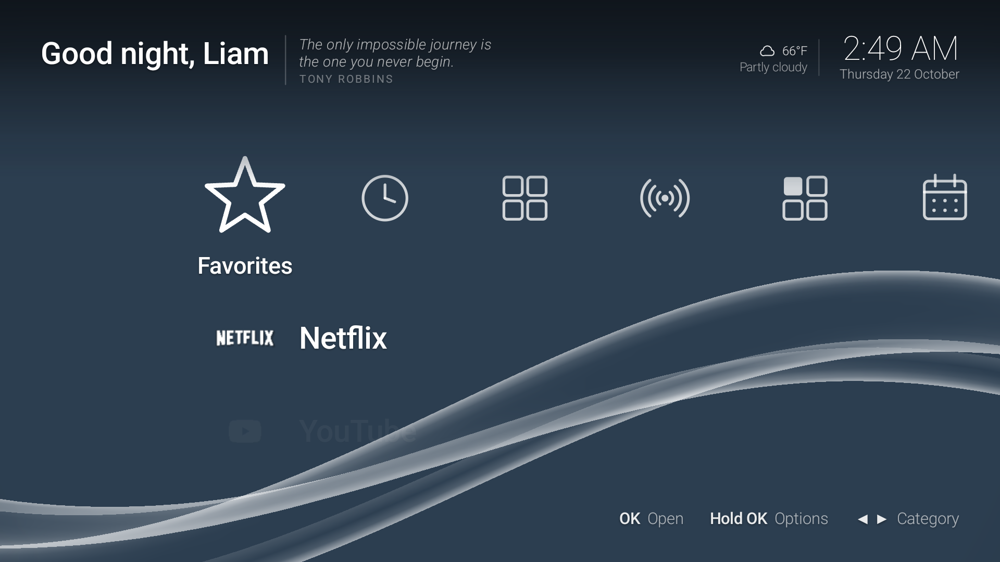
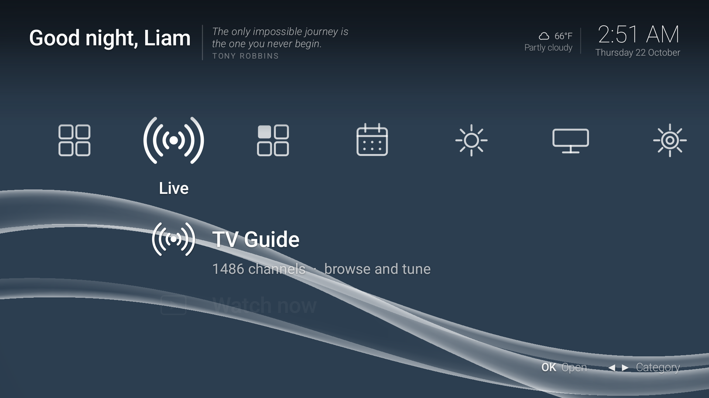
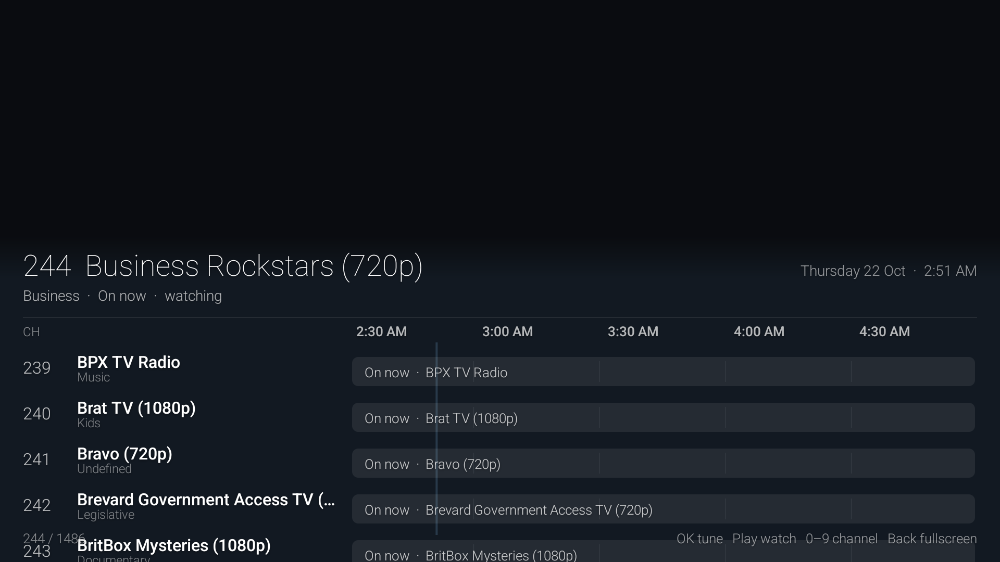
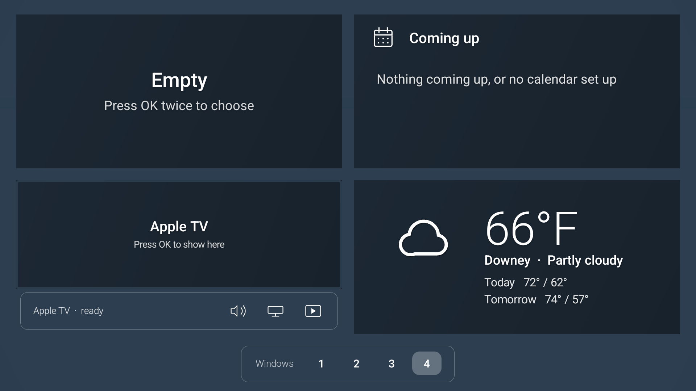

# TV Home

Android TV launcher with a PlayStation-inspired Cross Media Bar, live TV guide, Multiview, and IPTV playback.

## Screenshots

### Home



### Favorites



### Live



### TV Guide



### Multiview



## Build the APK

Requires JDK 17+ and Android SDK platform 34 / build-tools 34.0.0.

```bash
export ANDROID_HOME=/path/to/android-sdk   # optional if already set
cd launcher
./build.sh            # → launcher/build/home.apk
./build.sh install    # build + adb install (ADB_TARGET=serial optional)
```

## CI

GitHub Actions (`.github/workflows/android.yml`):

- **push / pull_request** — compile and package `home.apk`; fail the check if the build breaks
- **release** — same build, then attach `home.apk` to the published release

Create a release (e.g. tag `v1.0.0`) to get a downloadable APK on the Releases page.
